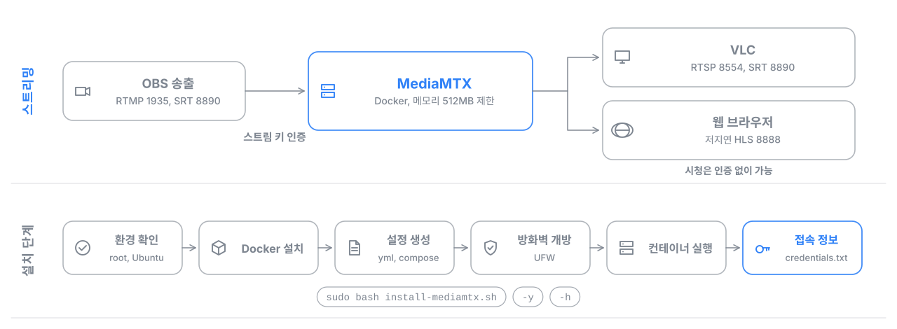

# MediaMTX 스트리밍 서버 설치 스크립트

Ubuntu 24.04에 Docker 기반 MediaMTX 저지연 스트리밍 서버를 명령 한 줄로 설치합니다. OBS로 송출하고 VLC나 웹 브라우저로 시청하는 구성을 1GB RAM 서버에서도 돌아가도록 맞췄습니다.



## 주요 기능

- 스트림 키 인증: 송출만 인증하고 시청은 자유
- RTMP, SRT 송출과 RTSP, SRT, 저지연 HLS 시청 지원
- Docker 자동 설치, UFW 방화벽 포트 자동 개방
- 컨테이너 메모리 512MB 제한 등 저사양 서버 설정

## 설치

스크립트를 내려받은 뒤 원하는 방식으로 실행합니다.

```bash
wget -O install-mediamtx.sh https://raw.githubusercontent.com/NAMUORI00/mediamtx-installer/master/install-mediamtx.sh
```

| 방식 | 명령 |
| --- | --- |
| 대화형 설치 (권장) | `sudo bash install-mediamtx.sh` |
| 기본값으로 설치 | `sudo bash install-mediamtx.sh -y` |
| 포트 지정 | `sudo RTMP_PORT=1936 HLS_PORT=8080 bash install-mediamtx.sh -y` |
| 스트림 키 지정 | `sudo STREAM_KEY=<스트림 키> bash install-mediamtx.sh -y` |
| 도움말 | `bash install-mediamtx.sh -h` |

스트림 키는 비워 두면 16자로 자동 생성되며, 설치가 끝나면 화면과 `/opt/mediamtx/credentials.txt`(root만 읽기 가능)에 표시됩니다. 직접 지정하면 명령이 셸 기록에 남으므로 자동 생성을 권장합니다. 같은 키를 SRT 암호로도 쓰기 때문에 직접 지정할 때는 10자 이상으로 정합니다.

## 설정 옵션

| 환경 변수 | 기본값 | 설명 |
| --- | --- | --- |
| `RTMP_PORT` | 1935 | OBS 송출 (TCP) |
| `RTSP_PORT` | 8554 | VLC 재생 (TCP) |
| `HLS_PORT` | 8888 | 웹 브라우저 재생 (TCP) |
| `SRT_PORT` | 8890 | 저지연 송출과 재생 (UDP) |
| `API_PORT` | 9997 | 관리 API (TCP, 내부망에서만 접근) |
| `STREAM_KEY` | 자동 생성 | 송출 인증 키 |

## 사용 방법

**OBS 송출**: 설치 후 출력되는 서버 URL을 OBS에 넣고 스트림 키 칸은 비워 둡니다.

```text
rtmp://<서버 IP>:1935/live?user=publisher&pass=<스트림 키>
```

**시청**

| 방법 | 주소 |
| --- | --- |
| VLC (RTSP) | `rtsp://<서버 IP>:8554/live` |
| VLC (SRT) | `srt://<서버 IP>:8890?streamid=read:live` |
| 웹 브라우저 | `http://<서버 IP>:8888/live` |

VLC에서 지연을 줄이려면 도구 > 환경설정 > 입력/코덱에서 네트워크 캐싱을 50ms로 낮춥니다.

## 서비스 관리

```bash
docker compose -f /opt/mediamtx/docker-compose.yml up -d    # 시작
docker compose -f /opt/mediamtx/docker-compose.yml down     # 중지
docker logs -f mediamtx                                     # 로그
```

설정 파일은 `/opt/mediamtx/` 아래 `mediamtx.yml`, `docker-compose.yml`, `credentials.txt`로 생성됩니다.

## 요구 사항

- Ubuntu 24.04, root 권한
- 메모리 1GB 이상, 2 vCPU 권장
- 위 포트에 대한 외부 접근 허용

## 라이선스

MIT License
